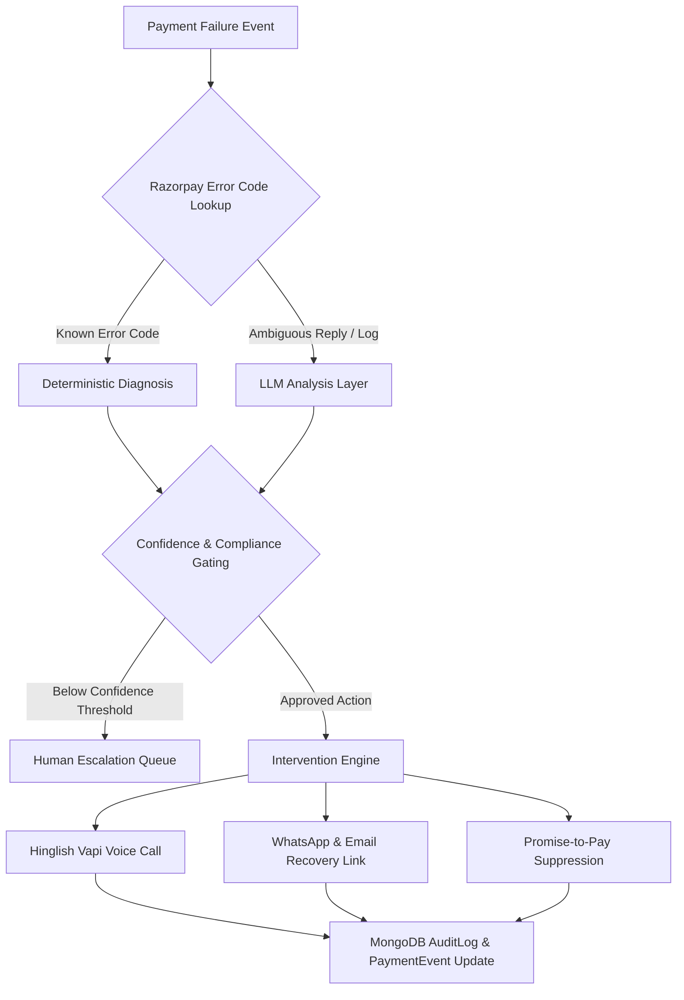

# 🎟️ BietHub — AI Revenue Recovery Platform
### *Razorpay AI Buildathon · Track 03: Closed-Loop AI Revenue Recovery*

BietHub is an intelligent, closed-loop revenue recovery platform designed to eliminate involuntary churn caused by subscription and event payment failures. By combining deterministic classification with LLMs, Hinglish Vapi voice agents, and strict compliance guardrails, BietHub turns payment failures into automated, empathetic recovery channels.

---

## 🚀 Key Features

* 🧠 **Hybrid Diagnosis Engine:** Instant deterministic classification for Razorpay decline codes + LLM analysis for ambiguous user text/replies.
* 🎙️ **Interactive Hinglish Voice AI (Vapi Integration):** Direct voice recovery agent that calls members, collects failure reasons, and sends payment links directly to WhatsApp and Email.
* 🛡️ **Promise-to-Pay (PTP) & Compliance Guardrails:** Bounded playbooks that suppress nudges when users commit to a payment date or explicitly opt out.
* 📊 **Live Recovery Dashboard & Admin Simulator:** Real-time visibility into recovered revenue, cohort conversion rates, funnel breakdowns, and audit logs.
* ⚡ **Human-in-the-Loop Escalation Panel:** Seamless queue routing for low-confidence or high-value cases requiring custom discount offers or manual overrides.
* 🧪 **Batch Harness & Confusion Matrix Evaluation:** Evaluates pipeline performance across 100+ synthetic subscriber events with precision/recall reporting.

---

## 🛠️ System Architecture



---

## 💻 Tech Stack

* **Frontend:** React 19, Vite, Tailwind CSS v4, Framer Motion, TanStack Query, Recharts, Lucide Icons, `@vapi-ai/web`.
* **Backend:** Node.js, Express.js, MongoDB (Mongoose), Nodemailer, Razorpay Orders & Subscriptions API.
* **Voice AI & Infrastructure:** Vapi AI Voice API, Ngrok Tunneling.

---

## ⚡ Quick Start Guide

### 1. Repository Setup

```bash
# Clone the repository
git clone https://github.com/themradul07/Event_Management.git
cd Event_Management

# Install frontend dependencies
npm install

# Install backend dependencies
cd backend
npm install
cd ..
```

### 2. Environment Configuration

Copy the example environment files and configure your API keys:

```bash
# Frontend env
cp .env.example .env.local

# Backend env
cp backend/.env.example backend/.env
```

### 3. Run Development Servers

```bash
# Start frontend (Terminal 1)
npm run dev

# Start backend (Terminal 2)
cd backend
npm run dev
```

The frontend will run at `http://localhost:5173` and backend at `http://localhost:5000`.

---

## 🎙️ Testing the Voice Recovery Sandbox (`/phone`)

1. Open your browser and navigate to `http://localhost:5173/phone`.
2. Enter a phone number, select a failure cause (e.g. `checkout_abandoned`), and click **"Trigger Test Call"**.
3. Answer the incoming simulated call in the browser to interact live with the **BietHub Hinglish Voice Agent**.
4. Test stating failure reasons or requesting a payment link—the agent will automatically update MongoDB and dispatch WhatsApp/Email notifications!

---

## 📜 Presentation Transcript & Pitch Guide

A full 5-minute presentation transcript complete with timestamps, slide cues, delivery tips, and Q&A answers is available in **[`transcript.md`](file:///d:/C_O_D_I_N_G/BietHub/transcript.md)**.
